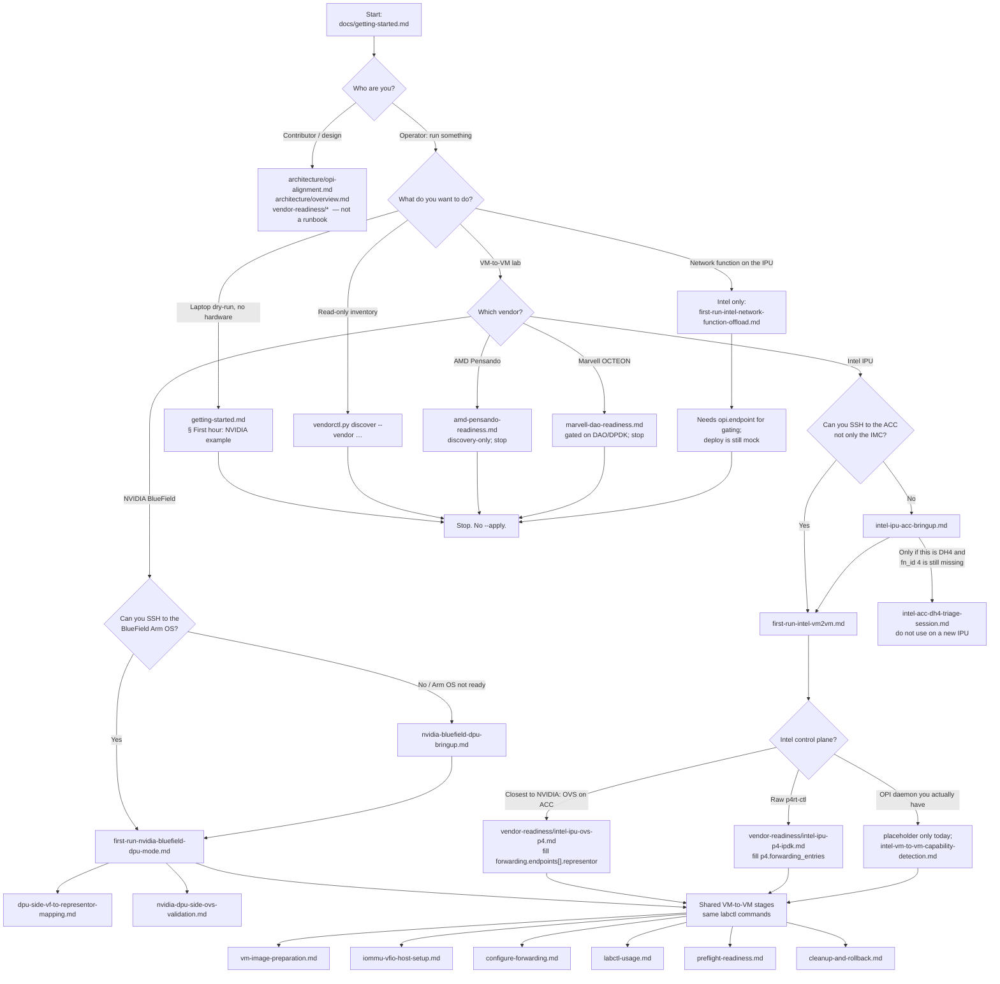

# Operator documentation flow

**Audience: operators.** This is the one page that answers “where do I
start?” and “what of OPI is in this lab?” Follow the flowchart for your
use case; do not read `vendor-readiness/` as a runbook.

Canonical start: [`../getting-started.md`](../getting-started.md).
Contributor OPI design: [`../architecture/opi-alignment.md`](../architecture/opi-alignment.md).

---

## The OPI tie-in (vendor-neutral)

**What of OPI this lab uses:** four published lifecycle/inventory calls,
over HTTP. **What it does not use:** gRPC, bridge attach, representors,
offload evidence, storage, or IPsec.

The messages are copied from
[opiproject/opi-api](https://github.com/opiproject/opi-api) commit
`0b58e48b3c91095621ffb1124b89094c6eac3ec7` into
[`../../kubernetes/opi/pinned/`](../../kubernetes/opi/pinned/README.md).
`tools/opi_server.py` serves the `google.api.http` routes in those
files. There is no generated stub and no `grpcio`, so `curl` is the
client. `grpcurl` has nothing to connect to.

The VM-to-VM run is still `tools/labctl.py`. Forwarding stays
`ovs-vsctl`, `p4rt-ctl`, or libvirt. The private
`apiVersion: odse.opi/v1alpha1` objects in
[`../architecture/api-model.md`](../architecture/api-model.md) are an
older envelope. This gateway does not add kinds there. Gaps that are
still missing from OPI itself (device id on `SetNumVfs`, representor,
local bridge attach) stay in
[`../architecture/opi-tie-in-roadmap.md`](../architecture/opi-tie-in-roadmap.md).

### HTTP gateway

```text
python tools/opi_server.py --config config/lab-nvidia-vm2vm.example.yaml
```

Listens on `127.0.0.1:8080`. Dry-run is the default. `--apply` writes
`sriov_numvfs` only when that config also has
`safety.dry_run_default: false`. The JSON body is the proto message.
Facts that are not proto fields go in `X-Odse-Opi-Limitation`.

| Call | Route | What you get |
|---|---|---|
| `GetDevices` | `GET /v1/lifecycle/devices` | Physical functions from the vendor plugin's `discover()`. A name that exists only in the YAML is not added. `health` is omitted because discovery does not report it. |
| `SetNumVfs` | `POST /v1/lifecycle/devices/vfs` with `{"vfCnt": N}` | Body is `{"vfCnt": N}` after the same sysfs check `prepare-vfs` uses. The PF is `dpu.pf_name`, because `SetNumVfsRequest` has no device id. AMD and Marvell return HTTP 501. A missing or unreadable PF returns HTTP 400 and does not write. |
| `Ping` | `GET /v1/lifecycle/heartbeat/ping` | `healthy: true` means SSH to `dpu.management_ip` accepted a command. Unset address or a failed SSH is `healthy: false`. |
| `GetInventory` | `GET /v1/inventory/<x>/inventory/<y>` | `pci[]` from `lspci -nn` (address, class, vendor, product, revision). BIOS, CPU, and memory are left empty. |
| `Init` | `POST /v1/lifecycle/init` | HTTP 501. `InitRequest` has no image and no procedure, so this route does not provision the card. |

```text
curl -s http://127.0.0.1:8080/v1/lifecycle/devices
curl -s http://127.0.0.1:8080/v1/lifecycle/heartbeat/ping
curl -s -X POST http://127.0.0.1:8080/v1/lifecycle/devices/vfs -d "{\"vfCnt\": 2}"
```

### What `labctl` stores

`discover` and `prepare-vfs` call the same Python functions. They do
not start the HTTP server. Representor and offload stay on
`not_opi` and are not proto fields.

| Stage | JSON field | Difference from the HTTP route |
|---|---|---|
| `discover` | `opi.get_devices` | Same discovered physical functions, and also adds a filled `dpu.pf_name` / `dpu.pf_pci` when discovery did not already list it. The HTTP route does not add that YAML name. |
| `discover` | `opi.get_inventory` | Fills `pci` only when the backend left raw `lspci -nn` text on `details.lspci`. Current NVIDIA and Intel discovery results do not, so `pci` is empty here. Use the HTTP `GetInventory` route when you want that PCI list. |
| `prepare-vfs` | `opi_set_num_vfs` | Shapes the SR-IOV result the stage already computed. It does not write a second time. `body` is the proto (`vfCnt` on success). `limitation` explains the missing device id. AMD and Marvell stay `http_status: 501`. |

### Still not this gateway

| Idea | Where it stands |
|---|---|
| `Init` | HTTP 501. The published request cannot provision a BlueField or an IPU. |
| Bridge attach / representors | `configure-forwarding` via `ovs-vsctl` or `p4rt-ctl`. Not an OPI RPC. |
| Intel `control_plane: opi` | Placeholder. It is not this HTTP server, and it is not submitted. |
| `labctl intel-nf` | Mock network-function deploy. Separate from these routes. |
| Offload `offloaded:yes` | `tools/offload-checker`. OPI has no telemetry proto in the pin. |
| OVN, libvirt XML, guest images | Stay where they are. This gateway does not replace `virsh`. |

---

## Flowchart

Start at the top. Take **one** branch. Open only the markdown for that
branch until a diamond says otherwise.



---

## Ordered docs by branch

Paths are from `docs/operations/` unless noted.

### Every operator

1. [`../getting-started.md`](../getting-started.md) — pick use case, then vendor.
2. This page — confirm the branch and the OPI answer above.
3. [`labctl-usage.md`](labctl-usage.md) — stages, dry-run vs `--apply`.
4. [`preflight-readiness.md`](preflight-readiness.md) — before any hardware mutate.
5. [`cleanup-and-rollback.md`](cleanup-and-rollback.md) — when tearing down.

### Laptop dry-run (no DPU required)

Stay on [`../getting-started.md`](../getting-started.md) “First hour”.
Config: `config/lab-nvidia-vm2vm.example.yaml`. Do not copy that file
onto Intel/AMD/Marvell hardware.

### Discovery only

[`../getting-started.md`](../getting-started.md#use-case-3-just-discovery--a-capability-report-no-lab-no-hardware-changes).
If `discover` finds nothing: same page, “Troubleshooting: discover finds
nothing”.

### VM-to-VM — NVIDIA BlueField

| If | Then open |
|---|---|
| Arm OS / BFB / OVS datapath types not confirmed | [`nvidia-bluefield-dpu-bringup.md`](nvidia-bluefield-dpu-bringup.md) |
| SSH to DPU works | [`first-run-nvidia-bluefield-dpu-mode.md`](first-run-nvidia-bluefield-dpu-mode.md) |
| Need `pf0vf0` mapping | [`dpu-side-vf-to-representor-mapping.md`](dpu-side-vf-to-representor-mapping.md) |
| Need OVS vs OVS-DOCA evidence | [`nvidia-dpu-side-ovs-validation.md`](nvidia-dpu-side-ovs-validation.md) |
| SSH plans vs apply | [`dpu-remote-execution.md`](dpu-remote-execution.md) |
| Guest images / IOMMU | [`vm-image-preparation.md`](vm-image-preparation.md), [`iommu-vfio-host-setup.md`](iommu-vfio-host-setup.md) |

Profile: `config/lab-nvidia-vm2vm.example.yaml` → `config/lab-nvidia-vm2vm.yaml`.

### VM-to-VM — Intel IPU

| If | Then open |
|---|---|
| You can only reach the IMC, or ACC SSH/ping fails | [`intel-ipu-acc-bringup.md`](intel-ipu-acc-bringup.md) §0–5 first. Do **not** start [`first-run-intel-vm2vm.md`](first-run-intel-vm2vm.md) until ACC SSH works. |
| New IPU / new firmware | Same ACC bring-up. Do **not** run [`intel-acc-dh4-triage-session.md`](intel-acc-dh4-triage-session.md). |
| Shared lab DH4 and `fn_id 4` still missing after ACC bring-up | [`intel-acc-dh4-triage-session.md`](intel-acc-dh4-triage-session.md) — that box only. |
| ACC SSH works | [`first-run-intel-vm2vm.md`](first-run-intel-vm2vm.md) |
| Closest to NVIDIA (bridge on ACC OVS) | [`../vendor-readiness/intel-ipu-ovs-p4.md`](../vendor-readiness/intel-ipu-ovs-p4.md); set `intel.control_plane: ovs`, `intel.require_opi: false`, fill `forwarding.endpoints[].representor` |
| Raw P4 table entries | [`../vendor-readiness/intel-ipu-p4-ipdk.md`](../vendor-readiness/intel-ipu-p4-ipdk.md); set `p4.mode: cli`, fill `p4.forwarding_entries` |
| You have a real OPI endpoint | [`intel-vm-to-vm-capability-detection.md`](intel-vm-to-vm-capability-detection.md). `--apply` still does not submit OPI. |
| Readiness codes | [`intel-ipu-readiness.md`](intel-ipu-readiness.md) |

Profile: `config/lab-intel-vm2vm.example.yaml` → `config/lab-intel-vm2vm.yaml`.
Do not copy NVIDIA PCI, representor, or `nvidia.datapath` fields.

### VM-to-VM — AMD / Marvell

- AMD: [`amd-pensando-readiness.md`](amd-pensando-readiness.md)
- Marvell: [`marvell-dao-readiness.md`](marvell-dao-readiness.md)

No NVIDIA-style `configure-forwarding --apply` path yet.

### Network-function offload (Intel only)

[`first-run-intel-network-function-offload.md`](first-run-intel-network-function-offload.md).
This is **not** VM-to-VM. It gates on `opi.endpoint` and still **mocks**
deploy. Config: `config/lab-intel-network-function-offload.example.yaml`.

### Shared VM-to-VM references (after the vendor first-run)

- [`lab-runbook-vm2vm-single-dpu.md`](lab-runbook-vm2vm-single-dpu.md) — 16-stage pipeline
- [`configure-forwarding.md`](configure-forwarding.md)
- [`vm-image-preparation.md`](vm-image-preparation.md)
- [`vm-vfio-assignment.md`](vm-vfio-assignment.md)
- [`iommu-vfio-host-setup.md`](iommu-vfio-host-setup.md)
- [`../config/README-lab-vm2vm.md`](../../config/README-lab-vm2vm.md)

---

## Do not start here (unless you are a contributor)

These are roadmaps and gap-tracking, not operator runbooks:

- [`../vendor-readiness/`](../vendor-readiness/README.md)
- [`milestone-backlog.md`](milestone-backlog.md), [`vendor-implementation-roadmap.md`](vendor-implementation-roadmap.md)
- [`../architecture/`](../architecture/README.md) except the OPI answer
  linked at the top of this page
